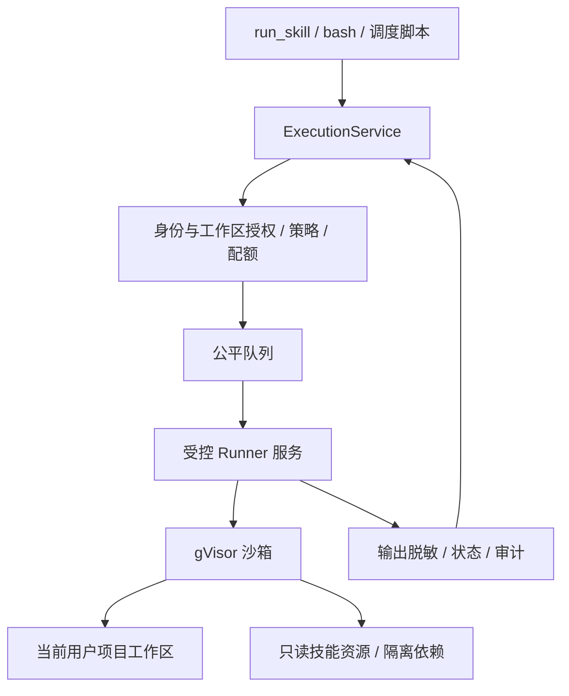

# Skill 脚本沙箱与用户目录隔离方案

状态：待实施。日期：2026-10-29。本文描述目标设计，不代表当前系统已经提供沙箱隔离。

## 1. 决策与适用范围

Antler 多用户服务器采用 **OCI 容器镜像 + gVisor runsc** 执行 Python、Shell 及技能依赖安装。按 Run 按需创建执行环境，同一 Run 内复用，结束后销毁；用户文件独立持久化。只进行模型推理、读取技能说明时不启动沙箱。

个人桌面模式保留显式配置的本机执行。共享服务器必须使用沙箱，沙箱不可用时拒绝执行，不能自动回退到宿主机。普通容器可用于开发对照测试，不作为共享服务器执行不可信脚本的上线配置。

首版不自建 microVM 调度系统。保留执行器抽象，后续可接入 microVM 或托管沙箱。若目标部署无法运行 runsc，必须重新选择隔离提供方，不能以降低隔离强度代替。

## 2. 当前实现与风险

当前执行机制见 [skill-execution.md](./skill-execution.md)。主要入口：

| 位置 | 当前行为 | 目标变化 |
| --- | --- | --- |
| `backend/src/skills/skill-tools.ts` | `run_skill` 准备运行副本，然后调用工作区 bash | 调用统一执行服务，传入已授权的技能版本 |
| `backend/src/skills/skill-runtime.ts` | 在工作区创建可写资源副本并复用依赖 | 保留源指纹校验，拆分只读资源与可写安装目录 |
| `backend/src/agent/workspace-tools.ts` | 文件工具检查路径；bash 在宿主机执行 | 文件工具保留路径限制；bash 接入沙箱 |
| `backend/src/agent/secret-guard.ts` | 环境变量过滤及输出脱敏 | 继续作为凭据保护措施，不承担文件系统隔离 |
| `backend/src/scheduler/executor.ts` | 启用的脚本任务直接创建宿主机子进程 | 接入统一执行服务，无归属任务不得执行 |
| `backend/src/platform/agent-workspace.ts` | 默认按 agentId 分配目录，股票 Agent 可使用共享种子项目 | 按用户与项目解析工作区，种子仅作为只读模板 |

Python 的 `open()`、`pathlib` 和子进程不会经过 TypeScript 文件工具的路径检查。设置 `cwd`、环境变量和命令文本过滤，无法阻止脚本访问后端账号有权限访问的其他文件。

威胁模型包括恶意技能、提示注入、依赖安装脚本和模型生成命令；攻击目标包括跨用户读写、宿主机文件访问、内部网络访问、凭据窃取和资源耗尽。已获得宿主机管理员权限的攻击者不在本方案的隔离承诺内；沙箱也不能阻止获准读取本用户文件的代码破坏这些文件，需要备份与版本恢复补充。

## 3. 技术选型

| 方案 | 隔离特点 | 成本与限制 | 决策 |
| --- | --- | --- | --- |
| 普通 OCI 容器 | 通过命名空间等机制隔离，仍共享宿主机内核 | 集成简单，应用直接使用宿主机内核接口 | 开发对照，不作为不可信多租户执行基线 |
| gVisor | 用户态应用内核代理大量系统接口，减少宿主机内核暴露面 | 需实测系统调用兼容性及文件、网络密集型任务性能 | 首版服务器执行方案 |
| microVM，以 Firecracker 为例 | 硬件虚拟化与独立客户机内核 | 需要 KVM、内核及 rootfs 管理、客机通信和存储网络编排 | 更高隔离需求或兼容性需求时评估 |

gVisor 的 runsc 可接入现有 OCI 工具，因此镜像管理与沙箱隔离可分别由 Docker/containerd 和 runsc 承担。兼容性必须以真实技能验证，不能承诺所有 Linux 程序均可运行。[官方架构说明](https://gvisor.dev/docs/)、[兼容性说明](https://gvisor.dev/docs/user_guide/compatibility/)。

Firecracker 需要 Linux/KVM，以及客户机内核和根文件系统；生产部署还需配置 jailer。它的主要额外成本是执行平台建设，不能仅按启动耗时判断是否采用。[官方入门文档](https://github.com/firecracker-microvm/firecracker/blob/main/docs/getting-started.md)。

## 4. 执行架构



API/Agent 进程不直接暴露或挂载 Docker socket。单独的 Runner 服务持有运行时权限，首版部署在专用 Linux 执行节点，与数据库及平台密钥分离。内部接口鉴权，仅接受固定结构的执行请求；镜像、挂载根目录、runtime 和资源上限由 Runner 校验。模型不能传入任意镜像、宿主机目录、运行时参数或特权选项。

执行上下文由认证身份和持久化 Run 记录构造，队列出队后再次检查 Run 是否仍有效。调度脚本使用持久化的所有者与项目授权；不存在可靠所有者的旧任务暂停迁移，禁止使用共享系统工作区执行。

建议新增 `backend/src/execution/`：

| 模块 | 职责 |
| --- | --- |
| `execution-service.ts` | 上下文、授权、队列、生命周期和输出处理 |
| `workspace-resolver.ts` | 根据用户/项目解析经过校验的存储标识 |
| `execution-policy.ts` | 计算网络、凭据、资源与镜像策略 |
| `providers/local.ts` | 桌面显式本机执行 |
| `providers/runner.ts` | 调用受控 Runner，不向模型暴露基础设施参数 |

建议接口如下，具体类型在实施时与现有 Run/Event 类型对齐：

```ts
interface ExecutionProvider {
  create(context: AuthorizedExecutionContext): Promise<ExecutionSession>;
  execute(
    session: ExecutionSession,
    request: ExecutionRequest,
    signal: AbortSignal,
    onOutput: (output: ExecutionOutput) => Promise<void>,
  ): Promise<ExecutionResult>;
  destroy(session: ExecutionSession): Promise<void>;
}
```

`AuthorizedExecutionContext` 仅由后端生成，包含用户、项目、Run、批准的技能快照和策略引用；`ExecutionRequest` 包含命令、当前技能引用及超时，不包含宿主机路径。命令通过结构化参数传递给容器内部 shell，禁止拼接为宿主机 shell 命令。

## 5. 用户目录与资源边界

持久化路径示意：

```text
<data-root>/users/<userKey>/projects/<projectKey>/workspace/
<data-root>/users/<userKey>/dependencies/<skillDigest>/<imageDigest>/<lockDigest>/
<runner-root>/runs/<runKey>/
```

内部 Key 由服务器生成或从可信记录解析，不直接拼接外部传入的 userId/项目名称。解析时核验归属、规范路径及真实路径，拒绝越界和符号链接重定向。目录由受控服务创建，用户代码无法修改挂载根目录的父目录；避免路径校验后替换造成竞态。宿主机文件工具同样要防范检查与打开之间的竞态，使用受约束的文件打开方式或转交 Runner 处理，不能将一次 `realpath` 检查视为完整安全保证。

| 沙箱路径 | 权限 | 生命周期 |
| --- | --- | --- |
| `/workspace` | 当前用户当前项目可读写 | 持久化，配额管理 |
| `/skills/<skillDigest>` | 当前 Run 已授权的技能原始资源，只读 | 平台版本管理 |
| `/install/<skillDigest>` | 独立安装沙箱中可写；运行沙箱中仅挂载已发布的只读依赖版本 | 安装副本在发布或失败后清理；已发布版本在宿主机依赖目录持久化 |
| `/tmp`、`/home/runner` | 临时可写，大小受限 | Run 结束清理 |

禁止挂载用户根目录、其他项目、后端源码配置、平台存储根目录、宿主机 HOME、运行时 socket 和设备。挂载目录中不能预先包含后端凭据文件；历史工作区中的 `.env` 等配置需先迁移到凭据管理再启用沙箱。只读挂载意味着不可修改，不意味着不可读取，因此任何挂载都应视为向脚本授权读取。

沙箱与宿主机之间的文件属主需要显式映射。首版为每个用户分配独立宿主 UID，沙箱以对应 UID 执行；共享模式的文件工具及报告下载通过受控 Runner 文件接口，以同一 UID 访问当前授权项目，不依赖后端进程的共享组权限。Runner 从已授权上下文解析 UID 和工作区，客户端不能指定任意 UID 或宿主机路径；文件接口仍须实施路径约束、防竞态打开、配额和写租约，并适用相同的输出脱敏规则。API/Agent 进程不直接打开用户工作区文件。

setgid 只保证组继承，不能保证组读写权限；`umask 022`、`0600` 文件和 `0700` 目录均不得依赖共享组解决。同 UID 文件接口应能正常处理 `0600` 文件及 `0700` 目录；代码主动移除属主权限导致无法访问时，返回明确的权限错误，由用户授权后在受约束路径内以该 UID 恢复权限，不自动以 root 读取或递归放宽权限。无法建立 UID 映射和受控文件接口的部署不得启用共享模式。

环境变量使用容器路径：`ANTLER_WORKSPACE_DIR=/workspace`；`ANTLER_SKILL_DIR=/skills/<skillDigest>`。每次命令仍创建新 shell，以 `/workspace` 为起始目录，`cd` 不跨调用保留。同一 Run 多技能共用执行环境意味着它们属于同一信任域，能访问该 Run 挂载的资源；需逐技能隔离的场景另建 session，不能声称具有逐技能边界。

Python 输出示例：

```python
import os
from pathlib import Path

output = Path(os.environ["ANTLER_WORKSPACE_DIR"]) / "reports/result.txt"
output.parent.mkdir(parents=True, exist_ok=True)
output.write_text("执行完成", encoding="utf-8")
```

首版对同一项目的写执行采用互斥租约，避免不同 Run 同时修改文件和依赖。租约按写操作（命令、依赖准备、文件工具写入）获取与释放，Run 结束并确认相关进程停止后释放，不按整个 Run 持有，避免长会话饿死同用户的其他任务。文件工具在租约被占用时快速失败并返回明确错误，由模型决定是否重试，不阻塞交互；调度脚本任务在公平队列中等待租约，等待超时按执行失败记录并告警。后续再评估快照与结果合并。

命令完成以该命令的所有进程停止为准，不能仅以 shell 退出或输出流关闭为准。首版不支持跨命令后台任务；Runner 必须在返回结果和释放项目写租约前终止并确认所有后代进程退出，包括 `nohup`、`setsid`、双重 fork 及关闭标准输出的后台进程。进程追踪须依赖经验证的运行时隔离与回收机制，不能只枚举父 PID 或发送进程组信号。若目标运行时无法可靠实现命令级回收，执行后销毁整个 session 并确认停止，下一命令重建。停止状态无法确认、租约续期失败或清理失败时隔离该项目，阻断新的写操作并告警；租约超时不代表旧写入者已经停止，不得仅凭租约到期放行其他执行。

## 6. 依赖安装与现有技能兼容

优先将常用解释器和依赖预装到平台批准、固定 digest 的镜像中。模型不能触发宿主机安装，也不能自行构建任意特权镜像。

原始技能保持只读。需要更新锁文件、在项目内创建 `.venv` 或执行 `uv run --project` 的技能，准备阶段先复制到 `/install/<skillDigest>`，再以该路径设置 `ANTLER_SKILL_DIR`。准备和执行使用相同容器内绝对路径，避免持久化虚拟环境中的 shebang 失效。安装沙箱停止且依赖发布完成后，在全新运行沙箱中以只读方式挂载已发布版本用于执行，不能依靠 chmod 阻止同 UID 代码修改；产生运行时可写文件的技能需改写到 `/workspace` 或 `/tmp`。

安装阶段必须使用独立的一次性沙箱，禁止将安装 session 切换挂载或升级权限后用作运行 session。安装器也必须在沙箱中执行，因为包安装可运行任意代码。安装阶段不挂载用户项目数据，不注入业务凭据，只提供技能副本和批准包源访问。安装命令完成后先终止整个安装沙箱，确认所有进程已停止、产物不再被写入，再由受控服务校验产物路径、文件类型、链接边界及配额，原子发布完整依赖版本；失败或无法确认停止的版本不发布、不复用。运行阶段仅接收已发布的依赖产物，不继承安装阶段的进程、临时目录、HOME 或网络连接；恶意依赖本身仍是不可信运行代码，受运行阶段策略约束。已发布依赖版本复用时挂载回其构建时的容器内绝对路径 `/install/<skillDigest>`；`/deps` 只是宿主机持久化位置，不作为容器内路径。这样虚拟环境中的 shebang 与绝对路径引用跨 Run 保持有效。缓存键至少包含用户、技能摘要、镜像摘要、依赖锁摘要和 CPU 架构；无锁依赖必须记录实际解析结果，不能以空锁摘要长期复用。

用户之间不共享可写缓存。Run 运行时使用不可变依赖版本；需要修改时生成新版本，不能污染正在运行的依赖。旧 `.antler/skill-runtimes/` 不是可信依赖来源，不直接搬入共享缓存。

## 7. 网络与凭据策略

默认无网络。需要外部 API 的技能采用平台批准的策略；技能声明仅是权限申请，不能自行授予权限。

联网任务只允许经过受控出口，阻止直连公网、内网、环回、云元数据地址及 IPv6 等旁路。出口代理验证目的域名与解析地址，处理 DNS 重绑定和重定向；仅配置 `HTTP_PROXY` 或 DNS 域名白名单不构成强制网络限制。依赖准备阶段只允许批准包源，运行阶段按实际业务服务开放。

使用显式环境变量白名单，不继承整个 `process.env`。沙箱不接收模型提供商平台密钥、数据库密码、SMTP 管理凭据等无关秘密。优先通过代理或后端工具代办敏感 API 请求；确需给脚本凭据时使用最小权限、短时凭据，仅在需要它的执行阶段注入。

`SecretGuard` 继续处理输出、错误和审计日志。脱敏不能阻止任意编码或获准网络下的数据外传，不能作为凭据隔离保证。

## 8. 生命周期与容量

状态建议为 `queued → preparing → running → cleaning → finished`，失败与取消也进入清理；现有 Run 状态保持兼容，执行阶段作为子状态或事件记录。首次执行才启动沙箱，Run 内命令顺序执行；同 Run 复用运行 session 的前提是每条命令结束后均能确认后代进程已回收，否则按第 5 节销毁重建。安装沙箱始终独立且不复用为运行 session。命令失败可由模型修复重试，但命令超时、取消、OOM 或 session 丢失后销毁整个 session，禁止在状态不明的环境内继续执行。

后端与 Runner 双侧实施超时。取消先停止接收命令，再终止整个容器及后代进程并回收。网络中断导致结果未知时返回明确错误，不自动重放可能已写文件的命令；使用 executionId 做幂等查询。Runner 用 Run 标签、租约和心跳回收孤儿；服务重启后扫描残留，不依赖 `--rm` 单独完成清理。

初始参数仅用于压测起点，不是容量承诺：

| 项目 | 建议起点 |
| --- | --- |
| 每沙箱 CPU / 内存上限 | 1 CPU / 512 MiB |
| 每沙箱进程上限 | 64 |
| 单命令超时 | 保留当前默认 30 秒、最大 60 秒 |
| 依赖准备超时 | 单独配置，起点 5 分钟 |
| 临时空间上限 | 128 MiB，根据真实技能调整 |
| 每用户并发 | 1 |
| 全局并发 | 由部署明确配置，按实测与机器容量决定 |

内存上限不是预分配量。容量以脚本峰值内存、runsc 开销、启动峰值和宿主机保留资源估算；同时评估 CPU、磁盘和网络，不能只以注册用户数决定实例数。限制队列长度及排队时间，按用户公平调度。工作区、依赖与临时目录均需文件系统配额或等效强制限制，Docker 可写层限制不能代替 bind mount 配额。输出持续读取但有累计字节和速率上限，避免缓冲爆炸。

## 9. 部署、配置与观测

执行节点要求 Linux、可用的 runsc 和经验证的容器运行时配置。容器使用非 root、只读根文件系统、移除 capabilities、禁止提权，无 privileged、host PID/network 或设备透传。具体 runtime 选项应以目标节点的兼容验证结果固定，不能复制一组参数后假定隔离已生效。macOS 开发可使用远程 Linux Runner；本机模式不能用于证明服务器隔离有效。

拟新增配置，尚未实现：

| 配置 | 约定 |
| --- | --- |
| `ANTLER_EXECUTION_MODE` | `local` / `gvisor`；共享服务器必须显式指定 `gvisor` |
| `ANTLER_RUNNER_URL` | 受控 Runner 内部地址，认证秘密独立管理 |
| `ANTLER_SANDBOX_IMAGE` | 平台批准的固定镜像 digest |
| `ANTLER_SANDBOX_MAX_CONCURRENCY` | 必填的全局执行上限 |
| `ANTLER_SANDBOX_USER_CONCURRENCY` | 默认 1 |
| `ANTLER_SANDBOX_MEMORY_MB` | 默认起点 512 |
| `ANTLER_SANDBOX_CPU_LIMIT` | 默认起点 1 |

部署配置显式标识桌面/共享服务器；不能以 `authMode=local` 或监听地址推断是否单用户。共享模式的启动检查验证 runtime、镜像、配额与出口策略；健康检查失败则阻断新执行。Runner 验证实际 runtime 为 runsc，不能仅相信请求中的名称。

审计记录用户、项目、Run、executionId、技能/镜像摘要、策略版本、runtime、排队/准备/执行/清理耗时、退出码、取消原因和资源峰值。命令可能包含秘密，日志必须脱敏且不记录凭据值。监控队列长度、OOM、超时、兼容性失败、孤儿数及清理失败；清理失败持续告警并停止向异常节点分配任务。

## 10. 迁移与实施阶段

1. **兼容性验证**：在目标 Linux 节点部署 runsc，运行真实 stock-analysis、报告生成及依赖安装。记录功能、峰值资源和延迟，与普通容器对照，确认网络策略可实施。
2. **执行入口收口**：新增 ExecutionService 和 provider，接入 run_skill、bash、调度脚本。审计其他可创建进程的入口，确保共享模式没有宿主机执行旁路。
3. **工作区迁移**：引入用户/项目归属解析；共享股票种子项目作为只读模板，为每个授权项目建立独立副本。无法确认归属的历史数据和定时任务暂停自动迁移，管理员明确归属后处理。已含凭据的工作区先迁出秘密。
4. **沙箱与依赖接入**：实现 Runner、队列、租约、挂载、准备阶段、配额、网络出口和双侧取消。更新 load_skill 的执行约定及 skill-execution.md，不再要求模型使用宿主机绝对路径。
5. **灰度与上线**：在隔离环境执行以下验收后，为指定测试用户开启；观察真实任务后逐步扩大。回滚时停止新的脚本执行、排空并清理沙箱，不能切回宿主机执行。保留用户成果和已备份的旧工作区，避免破坏性原地迁移。

每阶段完成实现后运行 `pnpm check` 和 `pnpm test`；真正的隔离测试必须在 Linux/runsc 集成环境执行，不可用 mock 测试替代。

## 11. 验收标准

| 类别 | 必须验证的行为 |
| --- | --- |
| 用户边界 | A 无法通过绝对路径、`..`、软链接、硬链接注入或子进程访问 B 的文件；挂载源及导入文件有相应限制；沙箱创建的文件在宿主机上的属主与权限符合映射方案，Runner 文件工具及下载接口可访问同 UID 的 `0600` 文件和 `0700` 目录；移除属主权限时返回明确错误，不越权读取或自动放宽权限 |
| 宿主机边界 | 无法读取宿主机凭据、后端配置、平台根目录或运行时 socket；容器中的 `/etc` 只属于镜像 |
| 运行时 | session 实际使用 runsc；缺失 runtime、错误配置或启动失败均拒绝执行，无普通容器/本机回退 |
| 网络 | 默认断网；联网策略能阻止直连、内网、元数据、IPv6 旁路、DNS 重绑定与重定向绕过 |
| 凭据 | 无无关秘密注入；输出、错误与日志脱敏；安装阶段不接触业务秘密和用户文件 |
| 生命周期 | 取消、超时、OOM、后端崩溃和 Runner 重启后，后代进程与孤儿环境均被回收；正常命令退出后，`nohup`、`setsid`、双重 fork 和关闭输出流的后台进程同样无法存活 |
| 资源 | 内存、进程、输出及实际挂载目录磁盘限额可强制生效；单用户无法占满队列 |
| 依赖 | 不同用户、技能版本、镜像及架构不混用可写环境；中断安装不污染已发布版本；安装脚本遗留的后台进程在发布前全部停止，不能在运行阶段访问用户文件或凭据；运行 session 不继承安装临时状态 |
| 并发 | 同项目互斥覆盖脚本及文件工具；租约占用时文件工具快速失败、调度任务等待超时按失败记录；重复 executionId 不重复执行写操作；后台延迟写入不能跨越租约释放，续租失败或清理状态未知时不得向新写入者放行 |
| 正常功能 | 真实技能能读取模板、安装批准依赖、调用批准服务、生成并下载报告 |
| 迁移 | 股票种子数据按用户独立复制；旧任务归属可追踪；旧会话路径变化有明确迁移提示 |

上线门槛：边界、回收与配额测试全部通过；所有计划上线技能通过功能验证；压测后确定并记录并发值、队列容量、资源预算及延迟目标。未通过的技能拒绝在共享服务执行，不以宿主机白名单绕过隔离。

## 12. 后续演进

当需要运行 gVisor 不支持的程序、面对更高风险的公开代码执行或需要不同内核能力时，以相同 ExecutionProvider 接口验证 microVM。性能选择基于真实任务的端到端耗时、峰值内存、文件传输与回收可靠性，不引用孤立的启动时间作为容量结论。

本方案降低跨用户与宿主机访问风险，不承诺绝对安全；运行时更新、镜像修补、访问控制、备份与审计仍是持续运维责任。
