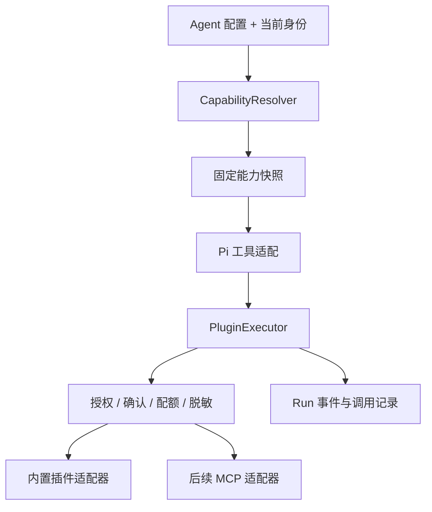

# Agent 插件能力规划

状态：提案，待实施。日期：2026-11-03。本文规划 Antler 的 Agent 插件，不涉及 Fastify 插件。

## 1. 目标与首版决策

让用户给 Agent 添加可配置、可授权、可诊断的外部能力，例如搜索、邮件、业务系统查询。Agent 配置决定可用工具，用户连接决定操作哪个账号，运行快照决定本次实际使用的能力。

建议按以下顺序落地：

1. 先建立统一工具注册与执行入口，将搜索、邮件、调度迁为内置插件。
2. 提供插件库、用户连接管理和 Agent 插件绑定，完成一个真实业务闭环。
3. 再接入 MCP，复用同一套绑定、凭据、快照和调用记录机制。

首版不开放用户上传任意 JavaScript、后端进程内动态加载代码、插件市场交易、前端扩展组件和运行中的工具热替换。现有 Skill 独立保留，不能通过安装 Skill 自动授予工具权限。

## 2. 当前基础与缺口

以下是当前代码事实，区别于后文目标设计：

| 当前实现 | 位置 | 插件化所需变化 |
| --- | --- | --- |
| 搜索、SMTP、调度按进程配置注入工具 | `backend/src/agent/pi-agent-adapter.ts` 的 `tools()` | 从已解析的 Agent 能力快照构造工具 |
| Agent 绑定 Skill，尚无插件绑定 | `backend/prisma/schema.prisma` 的 `Agent` / `AgentSkill` | 新增插件、连接、绑定实体 |
| 平台解析提示词与技能并计算 Agent 指纹 | `backend/src/platform/service.ts` 的 `resolveAgent()` | 把插件版本、工具描述和绑定策略纳入一致性检查 |
| 会话缓存校验 `contextFingerprint` | `backend/src/agent/pi-agent-adapter.ts` | 将工具配置变化纳入会话兼容性判断 |
| 运行保存技能快照并处理取消和事件 | `backend/src/agent/host-runtime.ts` | 增加能力快照、连接租约和调用生命周期 |
| 工具输出已有凭据脱敏 | `backend/src/agent/secret-guard.ts` | 注册连接密钥，统一覆盖插件结果、流式输出和错误 |

现有 Skill 的使用与执行约定见 [skill-execution.md](./skill-execution.md)。脚本沙箱仍为[待实施方案](./13-skill-sandbox-design.md)，插件化不能宣称已经提供执行隔离。

## 3. 产品模型

| 概念 | 职责 | 示例 |
| --- | --- | --- |
| Plugin：插件 | 定义能力、工具、配置与认证需求 | 邮件插件 |
| Connection：连接 | 某个主体对某项服务的配置和凭据引用 | 用户自己的邮箱连接 |
| AgentPlugin：绑定 | Agent 选择插件版本、工具范围与连接策略 | 允许读邮件，禁用发送 |
| Skill：技能 | 告诉模型如何组织工作、调用工具 | 客户邮件分类与回复流程 |

插件以后可以打包配套 Skill，但仍通过现有技能机制解析，并分别记录版本和授权。首版不调整现有 `Skill` 的命名与覆盖规则。

用户路径：

1. 在「插件」查看能力说明、工具列表、认证要求和状态。
2. 在「我的连接」填写服务配置与凭据，运行连接测试。
3. 编辑 Agent 时添加插件、选择允许的工具和连接策略。
4. 聊天前检查缺少的连接，给出可操作的配置入口。
5. 聊天工具卡显示插件名、操作、耗时、结果或失败原因；在连接管理中可以撤销连接。

Web 与 Mobile 共用接口及状态定义，先完成 Web 配置闭环，再接入 Mobile；服务端授权不能依赖客户端是否提供配置入口。

## 4. 绑定、身份与权限

**Agent 发布共享能力配置，不共享作者的个人连接。** 普通用户使用已发布 Agent 时，默认解析当前调用者自己的连接；定时任务解析任务所有者的连接。缺少连接时明确失败或提示配置，不能回退到作者账号或进程环境中的全局凭据。

绑定支持两种连接策略：

- `caller`：运行时使用调用者在该 Agent 绑定下选定的同插件连接；没有选择时，仅在恰好存在一个可用连接时自动解析，否则要求选择。
- `service`：使用管理员显式授权的服务连接；首版仅供内置插件和受控 Agent，记录可使用该连接的 Agent 与主体范围。普通 Agent 作者不能把个人连接转换为全站服务连接。

配置权、使用权分别校验：只有作者可修改 Agent 绑定，只有连接所有者或管理员可更新连接；查看已发布 Agent 不能读取连接配置、密钥或私有账号信息。模型参数中的 userId、connectionId、endpoint 均不能成为授权依据，执行上下文由后端生成。

最终工具集合为：插件声明工具 ∩ Agent 允许工具 ∩ 当前主体授权工具 ∩ 部署策略允许工具。注册工具时和执行调用时均检查，撤销连接或停用插件对后续调用立即生效。

工具声明 `read` / `write` / `destructive` 风险类别，作为策略输入，不仅凭类别推断业务安全性。首版外部写操作默认需要针对具体调用的确认；确认绑定 runId、toolCallId、参数摘要及有效期，参数变化必须重新确认。定时任务只有在创建时授权了明确工具与操作范围后才能无人值守执行，否则结束并提示需要交互授权。

该白名单仅约束插件调用入口。现有 `bash` / `run_skill` 仍有直接联网和宿主机执行能力，能绕过插件入口，因此不能将插件白名单描述为 Agent 的完整安全边界。多用户不可信代码执行依赖沙箱及网络策略落地；首版插件密钥不得注入通用 shell 环境。

## 5. 技术结构

建议新增 `backend/src/plugins-agent/`，与现有 Fastify `plugins/` 区分：

| 模块 | 职责 |
| --- | --- |
| `registry.ts` | 内置插件注册、版本与工具 schema 校验 |
| `capability-resolver.ts` | 解析 Agent 绑定、调用者连接与快照 |
| `connection-service.ts` | 连接归属、密钥引用、测试与撤销 |
| `plugin-executor.ts` | 调用时授权、确认、超时、取消、结果限制与审计 |
| `pi-tools.ts` | 转换为现有 Pi 工具协议 |
| `adapters/` | 搜索、邮件、调度及后续 MCP 适配 |

插件契约至少包含：稳定 id、不可变版本、名称、描述、配置 schema、认证类型、工具列表、各工具输入 schema、风险声明、超时及结果上限。工具使用稳定的命名空间，并校验模型供应商的名称限制；对模型名称到内部 `{pluginVersionId, toolId}` 的映射保持确定，拒绝碰撞。

内置插件实现通过受控代码注册，不从数据库字段执行任意模块或命令。输入先校验再执行；结果经过大小限制和脱敏后进入模型、SSE 与日志。工具返回内容属于外部数据，不能修改系统授权。异常映射为稳定错误码，保留可诊断的脱敏信息。

取消信号贯穿适配器。取消或超时不等于外部副作用已撤销；无法确认写入结果时返回“结果未知”，不自动重试。只读操作可有限重试，写操作仅在下游支持可靠幂等且保存幂等键时重试。

## 6. 数据与运行一致性

建议实体，具体字段在实施迁移时与现有模型对齐：

| 实体 | 主要字段与约束 |
| --- | --- |
| `Plugin` | 稳定 key、展示信息、启停状态；内置插件由服务端同步 |
| `PluginVersion` | pluginId、version、manifest、digest；内容不可变，唯一 `(pluginId, version)` |
| `PluginConnection` | ownerId、pluginId、连接类型、非敏感配置、secretRef、revision、状态 |
| `AgentPlugin` | agentId、pluginVersionId、allowedTools、connectionPolicy、受控 serviceConnectionId；首版每个 Agent 每插件一个绑定 |
| `PluginConnectionSelection` | userId、agentPluginId、connectionId；验证同插件及连接归属，避免每个 Agent 共用隐式账号选择 |
| `RunCapabilitySnapshot` | runId、插件版本摘要、工具 schema 摘要、策略摘要、连接 ID 与 revision；不存密钥 |
| `PluginInvocation` | runId、toolCallId、pluginVersionId、toolId、主体、连接引用、状态、耗时与错误码 |

凭据由后端密钥服务保存，数据库只存引用；若首版采用数据库密文，主密钥必须置于数据库之外，并支持密钥版本。API 只返回是否已配置和脱敏标识，写入后不回显。MCP 阶段需要的 OAuth 授权、刷新和撤销另行补齐，不在首版假定已经支持。

每次创建 Run 固定插件版本、工具描述与绑定策略；插件指纹纳入现有 Agent / context 指纹。工具集合或配置变化时，旧会话沿用现有 `agent_context_changed` 行为，提示新建会话，避免静默改变能力。

连接密钥轮换与撤销另行处理：凭据值不进入内容指纹，执行前解析当前有效凭据并复核授权；账号、端点或授权范围变化增加连接 revision，旧运行拒绝继续使用，重新 preflight。纯密钥轮换且账号及权限不变可继续使用。撤销权限优先于固定快照。

调用记录默认只存脱敏摘要和参数摘要值；需要确认的原始参数仅在受控的短期存储中保留。不得把完整邮件、令牌、附件或业务敏感结果默认写入审计表。日志沿用现有 runId / toolCallId 关联方式。

## 7. 接口草案

| 接口 | 用途 |
| --- | --- |
| `GET /api/plugins`、`GET /api/plugins/:id` | 列出可用插件、版本与工具描述 |
| `GET/POST /api/plugin-connections` | 当前用户连接列表与创建 |
| `PATCH/DELETE /api/plugin-connections/:id` | 修改或撤销自己的连接 |
| `POST /api/plugin-connections/:id/test` | 受限、无业务写入的连通性检查 |
| `GET/PUT /api/agents/:id/plugins` | 查看可见绑定；作者原子替换绑定并校验版本 |
| `PUT /api/agents/:id/plugins/:bindingId/connection` | 当前用户为该绑定选择自己的连接 |
| `POST /api/agents/:id/plugins/preflight` | 返回当前调用者缺失连接、不可用工具等诊断 |
| `POST /api/runs/:id/tool-calls/:callId/decision` | 提交本次调用的确认或拒绝 |

以上均为拟新增接口。连接测试需要归属校验、限流及端点策略，不能成为任意地址探测接口。绑定保存使用 revision 乐观并发控制；插件版本、工具名或权限非法时整体拒绝。preflight 只提供诊断，不能代替 Run 创建和工具调用时的检查。

## 8. 分阶段实施与验收

### P0：统一入口与内置插件

- 注册与执行抽象接入 Pi 两条模型路径，将搜索、邮件、调度迁入适配器。
- 没有插件的 Agent 保留工作区工具与已有 Skill；插件工具启用规则走新绑定。
- 进程级搜索/SMTP 配置只迁为管理员可见的服务连接，不自动授予所有已发布 Agent。迁移提供预览、显式绑定和兼容开关，切换窗口保留旧行为并明确标识，最终关闭全局注入。
- 验收：模型路径行为一致；命名无冲突；超时、取消、脱敏和禁用检查贯穿调用链；重复初始化不重复注册。

### P1：用户完整闭环，作为首个发布目标

- 落地连接、Agent 绑定、能力快照、确认与调用记录。
- Web 提供插件列表、连接配置与测试、Agent 绑定、聊天诊断和工具确认；Mobile 接入相同状态，配置页随后补齐。
- 以搜索验证读取，以邮件验证写入确认、撤销连接和结果未知处理，以调度验证任务所有者及授权范围。
- 验收：两个用户调用同一个已发布 Agent 使用各自连接；跨用户连接访问被拒绝；作者私有凭据不泄露；变更配置触发旧会话检查；撤销后后续调用被拒绝；断线重连不会重复发送邮件。

### P2：MCP 接入

- 引入 MCP 适配器，复用上述数据模型和执行治理。优先支持管理员登记的远程服务，具体传输、SDK 和协议版本在实施前核对官方文档。
- 拉取工具目录后生成候选版本，由管理员确认发布；远端工具列表和 schema 漂移时拒绝不匹配调用，不能直接改变活动 Run 的目录。
- 远程端点执行 SSRF 防护，检查 DNS 解析、重定向、目标网段与出站策略；认证刷新失败明确进入待重连状态。
- 本地进程型接入仅在桌面显式配置，或后续隔离 Runner 中运行；共享后端不执行用户提供的启动命令。
- 首轮只开放工具调用；资源、提示模板及其他协议能力按真实需求另行规划。

## 9. 测试与交付边界

回归测试重点为能力集合计算、连接归属、服务连接授权、配置指纹、撤销竞态、确认参数绑定、取消、外部写入幂等和定时任务授权。UI 测试覆盖连接配置 → 绑定 → preflight → 调用，以及缺少连接、拒绝确认与撤销后的反馈。

新增 Prisma 迁移随实现提交；内置插件迁移需要幂等、支持预览并记录旧配置映射。实现完成后运行 `pnpm check`、`pnpm test`，并对真实搜索和测试邮箱做受控集成验收。

本提案的首个交付范围为 P0 + P1；P2 在统一执行链路验证完成后启动。当前仅新增规划文档，未修改 Agent 工具行为、数据库或凭据配置。
