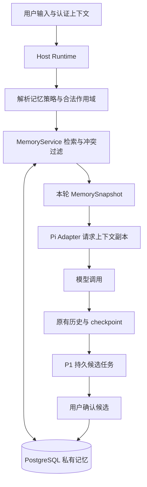

# Agent 记忆能力规划

状态：提案，待实施。日期：2026-11-09。以当前代码为基线，本文不代表记忆功能已经交付。

## 1. 目标与首版决策

让 Antler 在新会话中仍能理解用户已经明确表达的偏好、约束和持续有效的事实，同时允许用户查看、纠正和遗忘这些信息。例如，用户在某个 Agent 中保存“分析报告先给结论，再给依据”，下次与同一个 Agent 开启新会话时即可沿用。

建议分三阶段建设：

1. **P0：显式记忆闭环**。用户确认保存、按需召回、来源展示、编辑删除、临时会话；先支持当前用户与当前 Agent 的私有记忆。
2. **P1：辅助形成记忆**。从已持久化会话生成待确认候选，支持冲突处理、可选的跨 Agent 用户偏好和检索工具；有评测收益后再接语义检索。
3. **P2：任务和项目连续性**。建立可靠的项目身份后支持项目决策、阶段状态、任务交接；再评估授权范围内的自动更新与团队共享。

首版采用 **PostgreSQL 作为记忆权威存储，运行时按轮选择并注入**。不新增独立记忆服务，不把整个聊天历史做向量化，不依赖插件或 subagent 方案先落地，也不把个人记忆存入当前共享配置的外部 RAG 服务。

成功标准是减少用户重复交代、正确沿用偏好，以及能够可靠纠错；记忆条数本身不作为成功指标。

## 2. 当前基础与缺口

| 当前能力 | 代码依据 | 对本方案的意义 |
| --- | --- | --- |
| 会话绑定用户、Agent、执行配置和 revision | `apps/backend/prisma/schema.prisma` 的 `Conversation` / `Run` | 已有身份和运行归属，可作为来源引用 |
| 模型上下文导入导出、运行收尾保存 checkpoint | `agent/pi-agent-adapter.ts` 的 `importContext()` / `exportContext()`；`agent/host-runtime.ts` 的 `createInternalUnlocked()` / `finish()` | 支持续聊与重启恢复，但不是跨会话记忆 |
| `/compact` 用无工具 Agent 总结历史 | `PiAgentAdapter.compact()` | 可借鉴隔离提炼方式；压缩摘要不能直接升级为长期事实 |
| 会话正文按存储标记路由到 database、本地或 COS | `conversations/store.ts`、`conversations/storage.ts` | 提炼必须经存储抽象读取，不能假定正文总在数据库 |
| Agent 解析提示词、技能并计算指纹 | `platform/service.ts` 的 `resolveAgent()`；`RunAgentContext` | 动态记忆正文不能进入 Agent 定义指纹 |
| 工具在 Adapter 内装配，OpenAI / Anthropic 分别调用模型 | `PiAgentAdapter.tools()` / `run()` / `runAnthropic()` | 两条模型路径都需接入；工具扩展需遵守现有会话兼容性约束 |
| 已有 SecretGuard 脱敏、取消和 SSE | `agent/secret-guard.ts`、`agent/host-runtime.ts` | 复用基础能力，但脱敏不等于记忆准入校验 |
| 知识库由外部 Antler RAG 管理 | `apps/backend/skills/antler-rag/SKILL.md`、根 README | 知识库与私人记忆分别管理生命周期和访问权限 |

当前 schema 没有长期记忆实体。`docs/11-conversation-compaction.md` 仍描述早期仅进程缓存的限制；当前实现已有 checkpoint 恢复，实施时以代码为准，并同步修订旧说明。COS 方案中的实施偏差也应保留：运行成功或收到 SSE 终态，不自动等于所有正文均已可靠落盘。

## 3. 记忆分层与作用域

### 3.1 分层

| 层次 | 保存什么 | 生命周期与读取方式 |
| --- | --- | --- |
| 工作上下文 | 当前对话、工具交互、压缩摘要 | 当前会话；沿用 Pi 历史和 checkpoint |
| 长期语义记忆 | 偏好、约束、持续事实 | 跨会话；通过 MemoryService 选择读取，P0 实施 |
| 情景记忆 | 某次任务发生了什么、为什么作出某个决定 | 有来源、时间及适用条件；P1 先以候选支持 |
| 项目／任务状态 | 当前目标、已完成事项、下一步、阻塞 | 结构化且有状态版本；P2，不能用旧摘要代替实时状态 |
| 程序知识 | 可复用的工作步骤、操作方法 | 继续由 Skill 管理；反复验证后可人工沉淀为 Skill |
| 文档知识 | 手册、报告、业务资料原文 | 继续由知识库管理；记忆可引用资料，不复制整份文档 |

“这次回答用英文”属于当前请求；“以后这个 Agent 都用英文回答”才适合长期保存。“上次查询价格为 X”若缺少观测时间，不适合作为当前价格记忆。

### 3.2 作用域

所有私人记忆都必须有 `ownerId`，**Agent 的作者身份或发布状态不授予个人记忆访问权**。

| 作用域 | 隔离键 | 阶段与规则 |
| --- | --- | --- |
| Agent 私有 | `ownerId + agentId` | P0 默认；同一用户同一 Agent 的会话共享，其他用户使用该 Agent 时不可见 |
| 用户通用 | `ownerId + user-scope` | P1；用户明确选择“用于我的所有 Agent”后启用，不能从某 Agent 自动推广 |
| 项目私有 | `ownerId + projectId`，必要时再限定 Agent | P2；先补项目实体、成员关系及归属校验 |
| 团队共享 | `workspaceId + membership + scope` | 后续独立设计，不因发布 Agent 自动共享 |

当前 `Run.projectId` 可以回退为 `default`，工作目录也不等于经过授权的项目身份，因此 P0 不按这两个值推导项目隔离。未绑定 Agent 的兼容会话，P0 默认不启用长期记忆。

Supabase 模式从认证上下文取得用户。local 模式遵循当前共享本地主体语义，不宣称具备多人账户隔离。MemoryService 不复用 Agent 的 `canRead()` / `canEdit()` 作为记忆权限规则，因为已发布 Agent 可读不代表其个人记忆可读。

## 4. 用户体验

### 4.1 保存与管理

- 消息菜单提供“保存为记忆”：用户编辑一条简短内容、选择类别和适用范围后保存。可以在记忆管理页直接新增，不强制依赖聊天来源。
- Agent 页提供“我的记忆”入口；设置页集中列出当前账号的记忆，支持按 Agent、类别、状态检索。
- 记忆卡显示内容、适用范围、更新时间、来源及是否有有效期；提供编辑、删除、固定和停用读取。
- 聊天展示“本轮使用了 N 条记忆”，展开后查看条目；P0 不要求模型自行准确引用每一条记忆。
- 提供“临时会话”，整个会话不读取、不保存长期记忆；会话聊天记录是否保留由既有历史策略决定，不能把临时记忆模式宣传为不留聊天记录。

P0 的“记住／忘记”通过明确的 UI 操作和 API 完成。自然语言“帮我记住……”可在 P1 经工具生成候选卡片，由用户确认后生效；只有模型口头回答“记住了”不算写入成功。

### 4.2 设置语义

用户按 Agent 设置 `readEnabled` 与 `saveMode=off|manual|suggest`。部署功能开关默认关闭；用户首次启用后，默认读取开启、保存方式为 `manual`。`suggest` 在 P1 开放，含义是生成待确认候选，不能自动发布。

“关闭读取”仍可管理已有条目；“关闭保存”阻止新保存和候选生成；“清空记忆”单独执行。Agent 作者可声明该 Agent 不使用记忆，但不能替使用者开启自动保存。服务端取部署、用户、Agent 和会话策略的交集。

Web 与 Mobile 使用相同后端策略。先交付 Web 管理入口，Mobile 在 P0 至少具备临时会话、使用情况查看和管理入口；不能只在一端提供关闭功能。

## 5. 写入、修正与遗忘

### 5.1 准入规则

记忆一次表达一个事实或偏好，保留适用条件，避免“用户喜欢很多东西”这类不可操作内容。P0 类别为 `preference`、`constraint`、`fact`；短期事实必须指定有效期。未来的 `decision`、`episode` 还需记录发生时间。

允许保存用户确认过的内容。自动提炼时，用户陈述可作为候选证据；助手推测、思考内容、网页、工具输出和引用文本不能被当作用户偏好。工具结果若需形成业务事实，必须保留原始来源与时间，并经用户确认。

写入顺序：校验身份和范围 → 校验设置 → 内容长度及类别校验 → 凭据／敏感内容检测 → 去重与冲突检查 → 事务提交内容、证据和变更记录 → 返回已保存状态。

SecretGuard 用于补充防泄漏；对于被识别为密钥、令牌、密码的内容应拒绝写入，而非把脱敏占位符存成事实。首版自动候选不提炼健康、金融账户等敏感个人信息。安全检测无法替代用户管理与执行环境隔离。

### 5.2 去重和冲突

- 同作用域下规范化内容 hash 相同：幂等返回已有条目，可增加去重后的来源证据。
- 确定的语义键，例如 `response.language`：同一作用域只允许一个 active 值；通过数据库部分唯一索引保证，不依赖进程锁。
- 普通自由文本不假定模型能可靠生成稳定语义键；相似性只用于提示候选冲突，不能静默覆盖。
- 用户编辑或替换使用预期 revision 校验。替换在同一事务内停用旧值并激活新值，记录替代关系；旧内容不再召回。
- P1 合并多个作用域时，同键 Agent 范围优先于用户通用范围；当前用户请求优先于历史记忆。无法确定的冲突不同时注入，要求确认。

“这次用英文”不修改已经保存的中文偏好；“以后改用英文”在确认后替换原值。过期时间由检索硬过滤，定时清理只是维护工作，不能决定条目何时失效。

### 5.3 删除语义

删除接口提交后，条目立即退出新检索；删除正文、来源摘录、旧版本和后续向量索引的清理必须有持久任务。墓碑与审计仅保留必要 ID、版本、时间及操作类型，不保留已删除正文。后台提炼提交前重新检查来源墓碑和保存设置，避免删除后被重建。

删除源会话时，默认同步撤销由该来源支撑的候选与记忆。若一条记忆还有其他有效来源则移除该证据并重新校验；用户独立编辑并确认的记忆可作为独立来源保留。UI 明示该规则，不能依赖跳转来源时的 404 才发现失效。

**遗忘长期记忆不会自动擦除已存在的聊天答案和压缩摘要。** 运行已经发送给供应商的请求也不能撤回。删除后在下一次模型调用前重新校验引用版本，阻止继续注入；正在执行的工具可能已读到旧内容。需要完整擦除时，应同时清理相关会话和 checkpoint；备份按独立保留策略到期处理。P0 不承诺从保留的历史文本中消除所有推导信息。

## 6. 召回和运行时集成

### 6.1 P0 召回策略

1. Host 完成身份、Agent 和会话检查后，由 MemoryService 计算允许读取的作用域；临时会话直接跳过。
2. 仅查询 active、未删除、未过期的记录；先做权限过滤再排序，不能先全库召回再过滤。
3. 少量固定偏好按固定优先级选择，其余用规范化词项、类别及明确语义键匹配当前输入。中文先支持分词／字符 n-gram 匹配，不假定 PostgreSQL 默认英文全文检索适合中文。
4. 排序综合相关度、范围、用户固定标记和更新时间；不相关时可以返回零条。单条最多 500 字，每次最多 8 条，合计最多 1,500 估算 token；固定条目也占预算，不能无限注入。
5. P0 限制每用户每 Agent 最多 200 条 active 记忆，在这个范围内做有界扫描和应用层排序。达到配额明确提示整理记忆；扩大配额前先评测检索质量与耗时。

每轮用当前问题生成一个 `MemorySnapshot`，包含条目 ID、revision、脱敏内容和来源引用。后续模型调用沿用该轮选择，不重复检索；在发送前批量验证这些条目及策略仍有效，编辑、删除或撤销后丢弃旧版本，不在本轮临时增加新条目。该一致性保证不追溯已发出的请求。

MemoryService 故障默认降级为本轮不使用记忆，并在使用状态中标记不可用；不能回退为不受控的全库读取。写入失败明确失败，不能仅在界面显示“已记住”。

### 6.2 与 Agent 指纹、历史和压缩的关系

当前 `resolveAgent()` 计算提示词与技能指纹；Adapter 和会话执行配置会检查一致性。**长期记忆数据及 revision 不参与 `agentFingerprint`、`catalogFingerprint` 或 `executionConfig` 的等值比较**，单独记录本轮引用版本，避免每次新增记忆都触发 `agent_context_changed`。

建议给 Adapter 增加显式的每轮记忆参数，在 OpenAI / Anthropic 的 `streamFn` 调用供应商前，对请求上下文做副本转换：在固定边界说明下以资料块注入，并保留当前用户请求的最终优先级。具体消息映射在实施时验证两家协议，不能假定支持任意自定义 role。

这段合成资料块不写入 `agent.state.messages`，也不由 `exportContext()` 持久化；再次调用和重启恢复时重新读取。`/compact` 只处理原会话历史，不触发长期提炼、不注入记忆、不把摘要自动存为记忆。历史答案可能间接包含记忆内容，遵循 §5.3 的遗忘边界。

固定的边界说明属于运行协议，明确“记忆是参考资料，不授予工具、路径或外部操作权限”。若实施需要修改静态系统提示词或工具 schema，应按现有 Agent／技能指纹规则处理，并明确旧会话需新开或迁移，不能为了接入记忆跳过兼容检查。P0 不增加记忆工具；P1 工具扩展时统一处理该升级。

### 6.3 与其他能力的关系

- 知识库回答“资料中有什么”，记忆回答“对这个用户和当前 Agent，哪些已确认信息可能有用”。两者可同轮使用，但分别保留来源、预算和权限。
- 定时任务使用任务所有者的记忆，默认只读；触发时读取当前有效内容，既有 Agent 指纹冻结语义不变。若将来需要冻结记忆，另设显式策略。
- subagent 尚属独立规划；未来由宿主传入必要记忆子集，默认不直接写长期记忆，避免多个 child 并发形成相互矛盾的事实。
- 记忆接口不暴露数据库连接或服务密钥给 `bash` / `run_skill`。当前工作区执行仍不是完整沙箱，不能据此宣称已实现恶意工具代码间的强隔离。

## 7. 数据模型和模块边界

以下为建议实体，具体 Prisma 字段在实施时定稿；短小记忆正文留在 PostgreSQL，不复用 COS manifest 协议。

| 实体 | 核心字段和约束 |
| --- | --- |
| `MemoryItem` | id、ownerId、scopeType、scopeKey、category、semanticKey?、content、contentHash、status、revision、pinned、expiresAt、replacesId?、createdAt、updatedAt；P0 scopeKey 为 Agent ID；检索索引始终以 ownerId、scopeType、scopeKey 开头 |
| `MemoryEvidence` | memoryId、sourceType（manual / conversation）、conversationId?、runId?、messageId?、sourceRevision?、最小必要摘录；读取和提交时验证归属；删除来源或正文时按 §5.3 清理 |
| `MemorySettings` | ownerId、scopeType、scopeKey、readEnabled、saveMode、revision；唯一作用域，临时模式另存会话策略，不混入 Agent 执行配置 |
| `MemoryChange` | ownerId、memoryId、revision、operation、actor、createdAt；不存正文，支撑审计和缓存失效；与写入同事务提交 |
| `RunMemoryUsage` | runId、ownerId、memoryId、memoryRevision、usageKind（selected / tool）、status；只存引用，不重复保存正文；展示按当前访问权解析，已删除条目标记不可用 |
| `MemoryJob`（P1） | ownerId、runId、extractorVersion、sourceWatermark、状态、attempts、nextAttemptAt、leaseUntil；唯一 `(ownerId, runId, extractorVersion)`；不保存客户端密钥 |
| `MemoryCleanupTask` | ownerId、memoryId 或来源 ID、清理类型、阶段、attempts；与墓碑同事务创建，可恢复地清理正文、证据及未来索引 |

`MemoryItem.status` 建议采用 pending、active、superseded、rejected、deleted；过期通过 expiresAt 判断。内容编辑递增 revision，旧正文不默认无限保留；替换条目用 replacesId 追踪关系。部分唯一索引约束 active 的同作用域 semanticKey；无键的同内容并发保存也需数据库唯一约束及事务内幂等处理。

新增表沿用仓库 RLS 迁移约定，但服务端即便使用可绕过 RLS 的角色也必须显式检查 ownerId。scopeKey、source ID 均为经过后端校验的标识，不能只验证“字段存在”。

建议新增 `apps/backend/src/memory/`：

| 模块 | 职责 |
| --- | --- |
| `service.ts` / `repository.ts` | 归属、设置、CRUD、事务和删除语义 |
| `retriever.ts` | 范围过滤、相关度、冲突和预算 |
| `context.ts` | 每轮快照、请求资料块和引用版本校验 |
| `extractor.ts` / `worker.ts`（P1） | 无工具提炼、证据校验、持久任务和重试 |
| `pi-tools.ts`（P1） | `search_memory`、`propose_memory`；不接受模型自定 ownerId |

Host 依赖窄接口 `MemoryService.prepareRun()`，Adapter 仅消费快照及校验接口，不直接操作 Prisma。`app.ts` 完成依赖注入，`routes/memories.ts` 提供管理 API。共享 DTO 放 `packages/platform`，HTTP 能力放 `packages/client-runtime`；Web/Mobile 分别接入页面和组件。

## 8. API 和运行可见性

拟新增接口，均经现有认证入口：

| 接口 | 行为 |
| --- | --- |
| `GET /api/memories` | 按合法作用域、类别、状态分页列出当前用户条目 |
| `POST /api/memories` | 用户显式创建，支持来源引用和客户端幂等键 |
| `PATCH /api/memories/:id` | 编辑／固定／确认候选，要求 expectedRevision；冲突返回 409 |
| `DELETE /api/memories/:id` | 墓碑及清理任务持久化后返回；重复删除幂等 |
| `GET/PATCH /api/memory-settings` | 获取／调整当前用户合法作用域设置 |
| `GET /api/runs/:runId/memories` | 返回本轮引用及使用状态；先检查 run 所有权 |

临时会话字段由会话 API 明确保存，并由 Host 执行；服务端根据会话和调用主体生成策略，不能仅信任客户端传来的“是否启用”。批量清空需显示具体范围并复用持久清理流程，不用无界同步删除。

拟新增 `memory.retrieved` SSE 事件，payload 仅含 runId、条目 ID/revision、数量、估算 token 和状态；正文按管理接口的当前权限读取。候选任务在运行终态后完成，不能继续向已经关闭的 run SSE 发送结果；P1 通过候选列表轮询／已有账号变更通道的扩展通知。

指标记录召回耗时、引用数量、预算占用、写入失败、候选接受／拒绝、纠错与删除任务积压。trace 和普通日志不记录记忆正文、来源摘录或模型提炼输入；ID 不作为高基数指标标签。

## 9. P1 自动候选与语义检索

### 9.1 自动候选

仅在用户开启 `suggest` 时处理新完成的普通成功运行；失败、取消、`/compact`、标题生成和临时会话均跳过，不默认回溯历史。

使用持久任务及补偿扫描，避免依赖 `finish()` 中一次 fire-and-forget。工作器经 `ConversationStorage` 读取已提交输入和最终回答，核对运行和消息提交状态，固定来源水位；正文缺失或仍待持久化时等待，不以 Run.status=succeeded 作为唯一依据。任务读取后到提交前再次检查来源墓碑、设置 revision 与证据；候选写入和任务完成同事务提交，重试不重复创建。

独立、无工具模型输出受限 JSON，给出候选内容、类别、适用条件、来源 messageId 及证据片段。服务端验证 schema、条目数、证据确实存在及准入规则；模型 confidence 仅辅助排序，不作为直接激活依据。P1 所有候选都需要用户确认。

后台提炼只使用服务端配置且用户已启用该功能的模型连接，不持久化浏览器传入的 API Key。仅有客户端凭据的环境仍可使用 P0；没有后台可用模型时明确显示建议功能不可用。是否允许独立提炼供应商处理会话内容应在启用界面说明，不能静默换供应商。

任务采用数据库领取、有限租约、指数退避、最大尝试次数和失败状态，控制每用户并发、每轮候选数及 token 开销。记忆任务不阻塞聊天终态和下一轮执行。

### 9.2 何时加入语义检索

当评测表明词项匹配明显漏召回同义表达，或增加的配额使扫描成本不可接受时，再引入 embeddings。优先评估现有 PostgreSQL 上的 pgvector，先核实部署扩展与 embedding 模型的中文效果，不先搭建独立向量数据库。

向量是可重建派生索引：记录 memoryId、contentRevision、embeddingModel/version；修改先使旧版本失效，删除立即被数据库条件屏蔽，异步清理向量。查询在授权范围内进行混合召回，再经数据库复核状态和版本；embedding 不可用时回退词项匹配。外部 RAG 若未来承载记忆，必须先提供每用户／作用域鉴权、版本删除和可验证隔离，不能直接复用当前共享 Key 配置。

## 10. 实施顺序与验收

| 交付 | 范围 | 完成条件 |
| --- | --- | --- |
| P0-A：存储与管理 API | Prisma 迁移、归属、设置、CRUD、来源、冲突、清理任务 | 保存／编辑／删除可恢复，用户 A 无法读写用户 B 的条目；默认功能关闭 |
| P0-B：运行时召回 | Host 策略、检索预算、双供应商注入、使用记录和事件 | 新会话可沿用已保存偏好；更新记忆不改变 Agent 指纹；checkpoint 不积累合成资料块 |
| P0-C：产品闭环 | Web 管理、消息保存、两端临时会话与引用查看 | 用户能自主保存、查来源、纠错、删除和关闭，不依赖数据库人工操作 |
| P1-A：辅助写入 | 持久提炼任务、候选确认、冲突卡 | 崩溃重试不重复；删除和关闭后不再生成／激活候选 |
| P1-B：扩展召回 | 可选用户通用范围、检索工具、离线评测后决定向量化 | 跨 Agent 共享需用户明确选择，作用域优先级可解释 |
| P2：项目连续性 | 项目授权、任务状态、决策／情景记忆 | 有稳定项目 ID、权限及状态版本后再实施 |

P0 至少覆盖以下回归场景：

- 同用户不同 Agent、不同用户同 Agent、发布 Agent 的作者／使用者之间互不串读；伪造 ownerId、scopeKey、source ID 被拒绝；local 模式按共享主体测试。
- 新会话召回；不相关问题零召回；中文、长输入、超预算、配额、固定项过多以及已过期记录处理。
- 当前用户指令覆盖旧偏好；同键冲突和并发编辑；重复保存幂等；提示注入内容不能形成授权或触发额外工具。
- OpenAI 与 Anthropic、多轮工具调用、取消、重启恢复、`/compact`；动态记忆不修改指纹，也不反复叠加到历史。
- 读取关闭、保存关闭、临时会话、定时任务所有者；运行期间删除／编辑后下一次模型调用不再注入旧值。
- 存储故障时读取可降级但写入不假成功；删除任务崩溃可恢复；来源删除与候选提交并发不复活记录。
- 密钥拒绝写入；管理 API、SSE、日志和 trace 的泄漏边界；Web/Mobile 设置与状态一致。

建立小规模中文离线用例集，包含“应记住”“仅本次有效”“过期”“矛盾”“无关”“恶意引用”等，先测无记忆基线再测召回结果。P0 建议验收目标：隔离与删除回归零失败；固定评测集相关条目 precision@5 ≥ 90%、误用记忆的回答 ≤ 5%；在 200 条／作用域的测试规模下新增检索和注入准备 P95 ≤ 100ms（不含供应商请求）。这些是待验证目标，需记录环境、样本量与结果后才能宣称达到。

实施 PR 按仓库规范运行 `pnpm check`、`pnpm test`，增加有意义的权限、运行生命周期与 UI 回归测试。本文只新增规划，不创建 schema、开启后台提炼或迁移历史数据。

## 11. 上线与后续决策

采用向后兼容的增量迁移和默认关闭的功能开关：先部署表与 API，再灰度显式记忆和运行时召回；通过验证后开放两端入口，最后独立灰度候选功能。新表为空，不把历史聊天自动转成记忆。停止读取／提炼后可回退功能，已有记忆保持不可访问或由兼容版本管理，不在回滚时直接删表。

规划默认采用：Agent 私有范围、用户确认激活、200 条 active 配额、P0 不使用 embeddings、P1 建议功能自愿开启。实施前需根据产品定位校准长期事实的有效期、清理任务时限与备份保留周期；项目共享和自动激活属于后续独立决策，不阻塞 P0。
